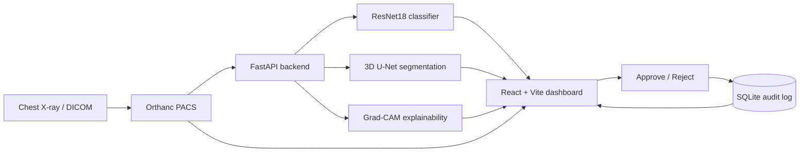
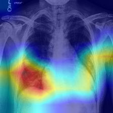
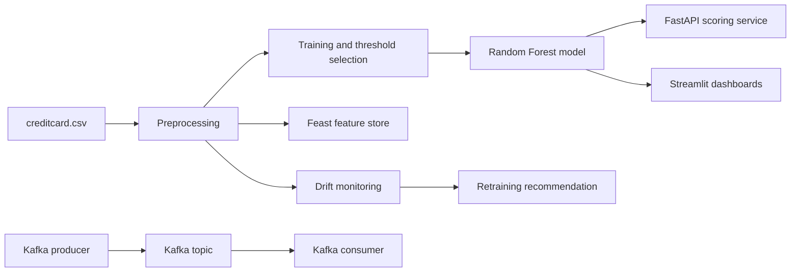
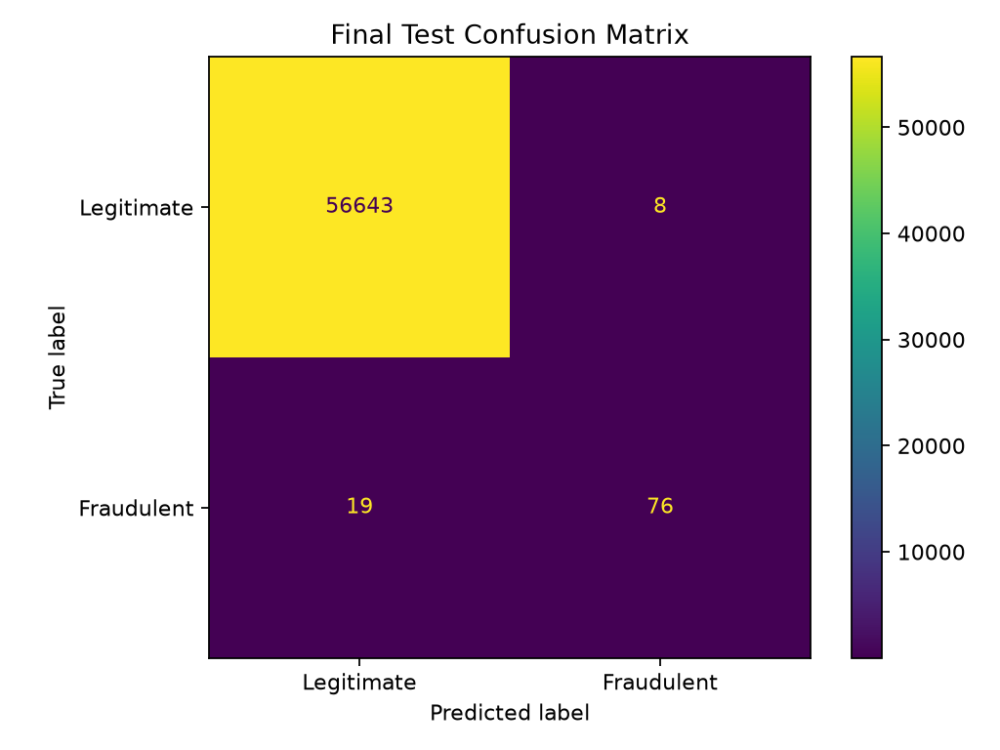

# Python AI/ML Projects

Two end-to-end educational machine-learning capstone projects developed for the **Nexvia Technologies Data Science internship**:

1. **MedVision** — medical-imaging classification, experimental 3D segmentation, Grad-CAM explainability, DICOM/Orthanc integration, and a clinical-review workflow.
2. **FraudGuard** — credit-card fraud-risk analysis with model comparison, threshold tuning, dashboards, a FastAPI scoring service, Kafka event simulation, a Feast feature store, and drift monitoring.

> **Responsible-use notice:** Both projects are educational prototypes. MedVision outputs must not be used for clinical diagnosis or treatment. FraudGuard is not connected to a bank or live payment network and must not be used for real financial decisions.

---

## Live demo

| Service | URL |
|---|---|
| MedVision frontend | <https://medvision-frontend-60an.onrender.com> |
| MedVision backend | <https://medvision-ai-backend-zc6t.onrender.com> |
| MedVision API docs | <https://medvision-ai-backend-zc6t.onrender.com/docs> |
| MedVision health check | <https://medvision-ai-backend-zc6t.onrender.com/health> |

**Live deployment scope:** The public MedVision deployment supports image classification and Grad-CAM. Segmentation and Orthanc monitoring are disabled on the Render Free instance (`ENABLE_SEGMENTATION=false`, `ENABLE_ORTHANC_MONITOR=false`) to stay within the 512 MB memory limit. The full workflow, including Orthanc and segmentation, runs locally with Docker Compose.

Render Free services sleep when idle; the first request after a pause can take roughly 40 seconds.

**FraudGuard is not publicly deployed.** It runs locally with Streamlit and FastAPI.

---

## Repository layout

```text
Python-AI-ML-Projects/
├── README.md
├── .gitattributes                 # Git LFS rules for large required files
├── .gitignore
├── Documentation/
│   └── Nexvia_Capstone_Presentation.pptx
├── AIML-01-Medical-Imaging-Diagnosis/
│   ├── README.md
│   ├── requirements.txt
│   ├── Dockerfile
│   ├── docker-compose.yml
│   ├── .env.example
│   ├── src/                       # FastAPI app, ResNet18, audit log, Orthanc monitor
│   ├── tests/test_api.py
│   ├── frontend/                  # React + Vite dashboard
│   ├── models/                    # classifier and segmentation checkpoints
│   ├── data/
│   │   ├── sample/                # sample chest X-rays and labels
│   │   ├── processed/             # train/validation manifests
│   │   └── segmentation/          # hippocampus dataset archive
│   ├── docs/                      # API, architecture, limitations, tests, screenshots
│   └── reports/                   # Grad-CAM, segmentation outputs, metrics
└── AIML-02-Financial-Fraud-Detection/
    ├── README.md
    ├── requirements.txt
    ├── requirements-deploy.txt
    ├── requirements-full.txt
    ├── Dockerfile
    ├── docker-compose.yml
    ├── k8s-deployment.yaml
    ├── .env.example
    ├── api.py                     # FastAPI scoring service
    ├── app.py                     # historical Streamlit dashboard
    ├── realtime_dashboard.py      # simulated transaction monitoring
    ├── feature_store/             # Feast feature definitions
    ├── models/                    # Random Forest, GraphSAGE, scaler, metadata
    ├── data/creditcard.csv        # dataset (Git LFS)
    ├── docs/                      # API, architecture, tests, screenshots
    └── reports/                   # metrics, matrices, drift and threshold reports
```

---

## Technology overview

| Area | MedVision | FraudGuard |
|---|---|---|
| Language | Python 3.11 | Python 3.x |
| ML | PyTorch, torchvision, MONAI (experimental) | scikit-learn, XGBoost, PyTorch Geometric |
| Backend | FastAPI + Uvicorn | FastAPI + Uvicorn |
| Frontend | React + Vite | Streamlit |
| Data / storage | DICOM, Orthanc, SQLite, DVC (original workflow) | CSV, Feast, Kafka, MLflow, Evidently |
| Deployment | Docker, Docker Compose, Render | Docker, Docker Compose, Kubernetes manifest |
| Testing | pytest, frontend build | pytest |

---

# Project 1 — MedVision

## Overview

MedVision is an educational medical-imaging platform that connects chest X-ray images and DICOM studies to experimental AI analysis. It includes a React dashboard, a FastAPI backend, an Orthanc DICOM server, a ResNet18 classifier, a 3D U-Net hippocampus segmentation experiment, Grad-CAM visualizations, and an approve/reject review workflow with an SQLite audit log.

## Features

- Chest X-ray classification with an experimental ResNet18 model.
- Grad-CAM and Grad-CAM++ heatmaps for classification explanations.
- Experimental 3D U-Net hippocampus segmentation.
- DICOM study browsing and previews through Orthanc.
- Reviewer approve/reject workflow with audit history.
- FastAPI endpoints for classification, segmentation, Grad-CAM, studies, reviews, and health.
- React/Vite dashboard with image upload, results, Grad-CAM display, and slice navigation.
- Docker Compose setup for Orthanc and the backend.
- Nine backend API tests and a verified production frontend build.

## Architecture



## Models and data

| Artifact | Size | Purpose |
|---|---:|---|
| `models/cardiomegaly_resnet18.pth` | 42.7 MB | Experimental cardiomegaly classifier |
| `models/hippocampus_3d_unet.pth` | 32 KB | Lightweight experimental 3D U-Net checkpoint |
| `data/sample/images/` | 18.4 MB | 633 sample chest X-rays from the NIH Chest X-ray14 dataset |
| `data/sample/hybrid_master.csv` | 57.0 MB | Sample metadata/labels used by the project |
| `data/segmentation/Task04_Hippocampus/Task04_Hippocampus.tar` | 27.1 MB | Medical Segmentation Decathlon Task04 Hippocampus archive |

The original project used DVC pointers for the sample data and segmentation archive. This combined repository stores the required data directly with Git LFS so a clone is self-contained. The per-project README is preserved and still describes the original DVC workflow.

## Run locally (Windows)

```cmd
cd AIML-01-Medical-Imaging-Diagnosis
python -m venv venv
venv\Scripts\activate
python -m pip install --upgrade pip
pip install -r requirements.txt

copy .env.example .env
REM Docker Compose reads .env automatically.
REM For direct uvicorn, set the same values in this terminal:
set ORTHANC_PASSWORD=change-me
set ENABLE_SEGMENTATION=false
set ENABLE_ORTHANC_MONITOR=false

venv\Scripts\python.exe -m uvicorn src.api:app --reload
```

Backend: `http://127.0.0.1:8000`  
API docs: `http://127.0.0.1:8000/docs`

In a second terminal:

```cmd
cd AIML-01-Medical-Imaging-Diagnosis\frontend
npm install
npm run dev
```

Frontend: `http://localhost:5173/`

## Docker (Orthanc + backend)

Build the backend image first, then start the stack. Docker Compose reads `.env` automatically.

```cmd
cd AIML-01-Medical-Imaging-Diagnosis
docker build -t medical-imaging-api:latest .
docker compose up -d
```

Orthanc: `http://127.0.0.1:8042/`  
Backend: `http://127.0.0.1:8000`

Set `ENABLE_SEGMENTATION=true` and `ENABLE_ORTHANC_MONITOR=true` in `.env` only when the host has enough memory and Orthanc is running.

## Tests

```cmd
venv\Scripts\python.exe -m pytest tests -q
```

Recorded result: **9 passed, 3 warnings**. The frontend production build also succeeds.

## Screenshots

| Dashboard | Grad-CAM overlay |
|---|---|
|  |  |

More screenshots: [`docs/screenshots/`](AIML-01-Medical-Imaging-Diagnosis/docs/screenshots/)

## Documentation

- [Project README](AIML-01-Medical-Imaging-Diagnosis/README.md)
- [System architecture](AIML-01-Medical-Imaging-Diagnosis/docs/architecture.md)
- [API reference](AIML-01-Medical-Imaging-Diagnosis/docs/API.md)
- [Test results](AIML-01-Medical-Imaging-Diagnosis/docs/test-results.md)
- [Limitations](AIML-01-Medical-Imaging-Diagnosis/docs/limitations.md)

---

# Project 2 — FraudGuard

## Overview

FraudGuard is an educational credit-card fraud-risk platform. It preprocesses an imbalanced transaction dataset, compares Logistic Regression, Random Forest, and XGBoost, tunes a decision threshold on validation data, and exposes the saved Random Forest model through a FastAPI service and Streamlit dashboards. It also demonstrates Feast feature retrieval, Kafka event simulation, graph-based experiments, drift monitoring, and retraining recommendations.

## Features

- Duplicate removal and preprocessing for 284,807 original transactions.
- Model comparison and validation-based threshold selection.
- Saved Random Forest model with documented evaluation metrics.
- FastAPI health, transaction-scoring, and Feast-feature endpoints.
- Historical Streamlit dashboard and simulated real-time monitoring dashboard.
- Kafka producer/consumer demonstration.
- Feast feature store with local retrieval.
- GraphSAGE fraud experiment and blended-model evaluation.
- Data-drift reporting and a retraining recommendation.
- Seven API tests and four real-time engine checks.

## Architecture



## Model and evaluation

The primary saved model is a **Random Forest** at decision threshold **0.25**.

| Metric | Result |
|---|---:|
| Test transactions | 56,746 |
| Accuracy | 99.9524% |
| Precision | 90.4762% |
| Recall | 80.0000% |
| F1-score | 84.9162% |
| Average precision | 0.803334 |
| ROC-AUC | 0.947420 |
| True negatives / false positives | 56,643 / 8 |
| False negatives / true positives | 19 / 76 |

The test set contains 56,651 legitimate and 95 fraudulent transactions. The model identified 76 of 95 fraud cases and incorrectly flagged 8 legitimate transactions. Accuracy alone is not a sufficient measure for this imbalanced problem.

## Dataset

`data/creditcard.csv` is the public credit-card fraud dataset commonly distributed through Kaggle.

| Characteristic | Value |
|---|---:|
| Original rows | 284,807 |
| Duplicate rows removed | 1,081 |
| Rows after deduplication | 283,726 |
| Legitimate transactions after deduplication | 283,253 |
| Fraudulent transactions after deduplication | 473 |

The dataset contains no real customer, device, or location identifiers. It is included here through Git LFS. The original FraudGuard README states that the dataset is not included; that statement describes the original standalone repository.

## Run locally (Windows)

The full dependency set is in `requirements-full.txt`. The minimal `requirements.txt` only covers the Streamlit demo.

```cmd
cd AIML-02-Financial-Fraud-Detection
python -m venv venv
venv\Scripts\activate
python -m pip install --upgrade pip
pip install -r requirements-full.txt
```

Historical dashboard:

```cmd
python -m streamlit run app.py
```

FastAPI service:

```cmd
python -m uvicorn api:app --host 127.0.0.1 --port 8000
```

Simulated real-time dashboard:

```cmd
python -m streamlit run realtime_dashboard.py
```

Kafka (optional demonstration):

```cmd
docker compose up -d
docker compose ps
```

Stop Kafka with `docker compose down`.

## Docker (API)

```cmd
cd AIML-02-Financial-Fraud-Detection
docker build -t fraudguard-api:latest .
docker run --rm -p 8000:8000 fraudguard-api:latest
```

## Tests

```cmd
pytest test_api.py -q
python test_realtime_engine.py
```

Recorded results: **7 API tests** and **4 real-time engine checks** passed. The Feast retrieval check runs separately:

```cmd
cd feature_store
python test_feast.py
```

## Screenshots

| Dashboard | Confusion matrix |
|---|---|
|  |  |

More screenshots: [`docs/screenshots/`](AIML-02-Financial-Fraud-Detection/docs/screenshots/)

## Documentation

- [Project README](AIML-02-Financial-Fraud-Detection/README.md)
- [System architecture](AIML-02-Financial-Fraud-Detection/docs/architecture.md)
- [API reference](AIML-02-Financial-Fraud-Detection/docs/API.md)
- [Test results](AIML-02-Financial-Fraud-Detection/docs/test-results.md)

---

## Datasets and Git LFS

Large required files are stored with **Git LFS**. Install Git LFS before cloning:

```bash
git lfs install
git clone <repository-url>
```

If the repository was cloned without LFS:

```bash
git lfs pull
```

List the LFS-tracked files:

```bash
git lfs ls-files
```

| Project | LFS file | Size |
|---|---|---:|
| MedVision | `models/cardiomegaly_resnet18.pth` | 42.7 MB |
| MedVision | `data/sample/hybrid_master.csv` | 57.0 MB |
| MedVision | `data/segmentation/Task04_Hippocampus/Task04_Hippocampus.tar` | 27.1 MB |
| FraudGuard | `data/creditcard.csv` | 143.8 MB |
| FraudGuard | `models/fraud_detection_model.joblib` | 8.0 MB |

The 633 sample chest X-rays are small enough to be stored as normal Git files.

The hippocampus archive is distributed as a `.tar` file. Extract it before running the segmentation scripts:

```cmd
cd AIML-01-Medical-Imaging-Diagnosis\data\segmentation\Task04_Hippocampus
tar -xf Task04_Hippocampus.tar
```

---

## Model artifacts

| Project | Artifact | Purpose |
|---|---|---|
| MedVision | `models/cardiomegaly_resnet18.pth` | ResNet18 cardiomegaly classifier |
| MedVision | `models/hippocampus_3d_unet.pth` | Experimental 3D U-Net checkpoint |
| FraudGuard | `models/fraud_detection_model.joblib` | Primary Random Forest model |
| FraudGuard | `models/fraud_gnn_weights.pt` | GraphSAGE experiment |
| FraudGuard | `models/gnn_scaler.joblib` | Graph experiment scaler |
| FraudGuard | `models/model_metadata.json` | Features, threshold, and metrics |

---

## Deployment notes

### MedVision on Render

- Frontend: static React/Vite build on Render.
- Backend: FastAPI on Render Free (512 MB).
- Memory safeguards: `MALLOC_ARENA_MAX=2`, single-threaded PyTorch/OpenCV, lazy imports, bounded Grad-CAM, and feature gates.
- Live health check reports `classification_loaded: true` and `segmentation_loaded: false`.
- Classification and Grad-CAM were verified end-to-end from the live frontend.
- Segmentation and Orthanc monitoring require the local Docker Compose stack.

### FraudGuard

- No public deployment is configured.
- The FastAPI service, Streamlit dashboards, Kafka demo, Feast feature store, and drift reports run locally.
- The Kubernetes manifest is provided as an extension and has not been verified against a live cluster.

---

## Security and credentials

- No `.env` file, API key, or access token is committed to this repository.
- Copy each project's `.env.example` to `.env` and set your own values.
- The original Medical Imaging project contained a demo Orthanc password. It has been removed from this copy; set `ORTHANC_PASSWORD` in `.env` before starting Orthanc or the backend.
- Never commit the real `.env` file.

---

## Limitations and responsible use

### MedVision

- Educational prototype; not clinically validated.
- Predictions may be wrong, and confidence scores are not necessarily calibrated probabilities.
- Grad-CAM heatmaps are explanatory aids, not proof that a prediction is correct.
- Segmentation performance is limited: recorded Dice scores on two samples ranged from 0.16 to 0.48.
- The sample data may not represent all patient populations, scanners, or acquisition settings.
- The live deployment does not include Orthanc study retrieval or segmentation.
- Clinical use would require privacy controls, independent validation, monitoring, and expert oversight.

### FraudGuard

- Educational prototype; not connected to a bank or live payment network.
- Metrics apply only to the evaluated historical dataset and do not guarantee real-world performance.
- The Kafka-to-API workflow is partially verified; end-to-end consumer scoring was not fully established.
- The graph experiment uses feature similarity, not verified customer, card, or device relationships.
- Drift monitoring compares historical batches and is not a live production signal.
- Kubernetes deployment remains unverified.

---

## Documentation

- [Nexvia Capstone Presentation](Documentation/Nexvia_Capstone_Presentation.pptx)
- [MedVision README](AIML-01-Medical-Imaging-Diagnosis/README.md)
- [FraudGuard README](AIML-02-Financial-Fraud-Detection/README.md)

---

## Author and acknowledgements

Developed by **Akshaya Gottimukkula** for the **Nexvia Technologies Data Science internship**.

Datasets and model references:

- NIH Chest X-ray14 sample data (MedVision).
- Medical Segmentation Decathlon Task04 Hippocampus (MedVision).
- Public credit-card fraud dataset commonly distributed through Kaggle (FraudGuard).

---

## License

No open-source license file is included in the original projects. Add an appropriate license before redistributing or reusing this work commercially.
